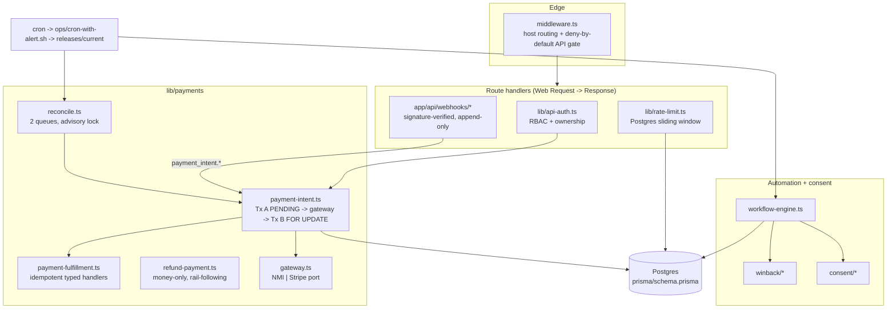
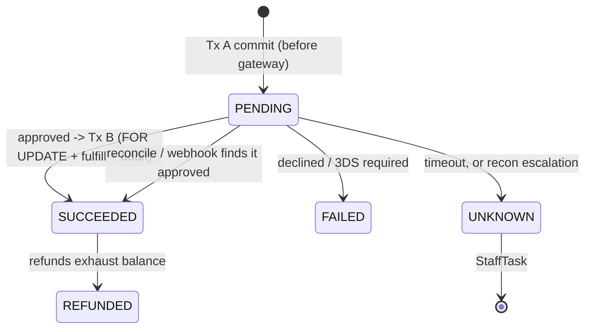

# studio-os-reference

A reference architecture for the hard parts of a single-location studio operating system: money that never goes missing, webhooks that can't be forged, automations that never spam, and releases you can prove are running.

Every module here was extracted from a production CRM, booking and billing platform built to replace two SaaS products, a hosted CRM/marketing suite and a booking/membership/billing vendor, for **a sauna & wellness studio**. The code is de-branded, simplified and **runs fully offline**: no API keys, no database, no network.

```bash
npm ci
npm test            # 97 tests, node:test via tsx
npm run demo        # walk through charge -> retry -> crash -> reconcile -> refund
npm run typecheck
```

## The problem

A small studio was paying for two SaaS products: a CRM with SMS/email workflows, and a booking platform that also handled memberships and card billing. Neither owned the whole customer, the data didn't line up, and the integrations between them were fragile. Replacing both meant taking over:

- **Card-on-file billing.** Renewals, packages, no-show fees, refunds, and a second payment gateway.
- **Customer messaging.** STOP/consent rules, business hours, touch limits.
- **Migration.** Moving thousands of live customers with active memberships off the vendor without a double charge or a missed renewal.
- **Operations.** One VPS, about 15 scheduled jobs, no ops team.

## Architecture



### Payment state machine



## Modules

| Area | Files | Pattern |
|---|---|---|
| Durable charges | `lib/payments/payment-intent.ts`, `payment-fulfillment.ts` | PENDING row committed before the gateway; Serializable finalize with row lock; idempotency key + `requestHash` misuse detection (409); idempotent handlers write output ids back into `contextJson` |
| Reconciliation | `lib/payments/reconcile.ts`, `scripts/reconcile-payments.ts` | Session advisory lock; stuck-PENDING queue (query gateway by persisted id); SUCCEEDED-but-unfulfilled queue; bounded retries -> UNKNOWN + StaffTask; per-row isolation |
| Refunds | `lib/payments/refund-payment.ts` | Money-only; follows the original row's rail; void vs refund; 24h partial gate; terminal failed row on decline |
| Dual rail | `lib/billing/rail.ts`, `period-window.ts`, `decline-reason.ts` | Enum-routed rail behind a default-off flag; context allowlist; stale billing-window guard; plain-English decline reasons |
| Webhooks | `lib/webhooks/*`, `app/api/webhooks/{stripe,resend}` | Raw-body HMAC (Stripe, Svix, SignalWire both schemes + port variant); `timingSafeEqual`; trusted-origin URL rebuild; append-only event row doubles as dedup guard; external-refund detection |
| Gateway + RBAC | `middleware.ts`, `lib/api-auth.ts` | Pure `decide()` policy (host isolation, deny-by-default APIs, forced password change); semantic permission map; customer ownership; constant-time shared secrets |
| Rate limiting | `lib/rate-limit.ts` | Postgres sliding window; rightmost-XFF client IP; fail-open; SHA-256-redacted audit; per-victim anti-relay limiter |
| Automation | `lib/workflow-engine.ts`, `lib/winback/*` | Staleness floor, send-time premise re-check, timezone business hours by message class, cross-workflow touch caps, kill switch |
| Consent | `lib/consent/*` | Unforgeable STOP-ack capability; create-only suppression with shared-number protection; AI-voice consent needs its own evidence |
| Migration | `migration/mirror-mode.md`, `scripts/mirror-sync.skeleton.ts` | One-way mirror, per-customer `billingOwner` cutover, change limits, keyed conflict queue |
| Release eng. | `ops/*`, `docs/release-identity.md` | Flocked deploy, atomic `.next` swap, source/BUILD_ID/served identity, systemd pre/post guards, crash-loop alerting, immutable cron releases, exit-code-preserving cron alerts |
| Schema | `prisma/schema.prisma` (27 models) + `prisma/sql/` | Trimmed from the production schema; partial unique index in raw SQL |

Decision records: [0001 pre-charge durability + reconciliation](docs/adr/0001-pre-charge-durability-and-reconciliation.md), [0002 dual-rail gateway](docs/adr/0002-dual-rail-gateway.md), [0003 release identity + immutable cron releases](docs/adr/0003-release-identity-and-immutable-cron-releases.md), [0004 mirror-mode migration](docs/adr/0004-mirror-mode-migration.md).

## Design rules

1. **Write the intent before touching money.** Every gateway call has a committed row that a human or a job can resolve.
2. **Typed outcomes, not booleans.** `succeeded | failed | unknown | requires_action | duplicate_* | idempotency_misuse`, with the HTTP mapping kept in one place.
3. **Replays are free.** Locks, idempotent handlers and dedup rows mean reconciliation, webhooks and client retries can all race safely.
4. **Fail closed on authentication, fail open on defense layers.** A missing webhook secret returns 503 and a bad signature returns 400 or 403. A rate-limiter database error lets the request through.
5. **Deny by default.** Every new API route is private until someone deliberately adds it to an allowlist.
6. **Re-check the premise at send time.** Enrollment is a snapshot, so a re-check runs before every message.
7. **The verified commit is the running commit.** This applies to the web process and to every cron job.
8. **No brand strings in code.** `BRAND_NAME`, `APP_TIMEZONE` and the hostnames come from config (`lib/config.ts`).

## Running it

- **Requirements:** Node 20+. Nothing else.
- **Tests:** `npm test` runs `tsx --test tests/*.test.ts` with Node's built-in `node:test`. Payments run against an in-memory store with transaction rollback and a scriptable `FakeGateway`. That gateway can approve, decline, time out, demand 3DS, or crash after capturing. The ops tests create throwaway git repos and run the real shell scripts.
- **Demos:** `npm run demo`, `npm run reconcile:demo`, `npm run mirror:demo`.
- **Schema:** `npm run prisma:validate`. Set `DATABASE_URL` to any placeholder Postgres URL.
- **Next.js:** `examples/next/` shows the thin adapters. Route handlers already take a Web `Request` and return a `Response`, so wiring them up is only dependency injection.

| Test file | Covers |
|---|---|
| `payment-intent.test.ts` | durability ordering, decline/unknown/3DS, Tx B rollback, idempotency (retry, misuse, concurrency), Stripe allowlist, tier step-down |
| `reconcile.test.ts` | crash-after-capture recovery, orphan and not-found escalation, per-row isolation, unfulfilled replay, advisory lock |
| `refund.test.ts` | void vs refund, 24h partial gate, balance tracking, replay, gateway-failure terminal row, rail-following |
| `webhooks.test.ts` | Stripe/Svix/SignalWire verification incl. rotation, tolerance, port variant; route-level dedup, finalize, external refund, email bounce semantics |
| `rate-limit.test.ts` | rightmost XFF, window + Retry-After, forged-XFF bucket, anti-relay, fail-open, redacted audit |
| `rbac-middleware.test.ts` | host isolation, deny-by-default, shared secrets, forced password change, permission matrix, ownership, cron secret |
| `billing.test.ts`, `workflow-consent-winback.test.ts`, `mirror-sync.test.ts`, `ops.test.ts` | rails, period windows, decline copy; dispatch gates; consent; win-back; mirror rules; deploy/publish/cron scripts |
| `test_dataset_hygiene.test.ts` | fails on any non-fictional phone, non-`example.com` email, or private term in the repo |

## Production context

The system these patterns come from ran a single-location sauna & wellness studio and **replaced GoHighLevel + Hapana**:

- **$97K processed natively across 963 payments** (2026-05-21 to 2026-10-20) through the durable-charge path above
- **9,985 customers and ~57K sessions** migrated and managed
- **85-model Prisma schema**, **318 API routes**, **970 commits**
- **10 live automation workflows**, **9,122 workflow runs**

## What was simplified

- **Storage.** Production used Prisma on Postgres with `$transaction({ isolationLevel: Serializable })` and raw `SELECT ... FOR UPDATE`. Here the money paths go through a small `Store`/`Tx` interface. The in-memory implementation is strictly serialized and rolls back on throw. A Postgres adapter has to honour the three guarantees documented in `lib/db/types.ts`. The rate limiter and advisory lock do ship `node-postgres`-compatible SQL adapters.
- **Amounts.** These are integer cents. Production stored `Decimal(10,2)` dollars.
- **Payment flows.** 4 of the 10 production flows are kept: membership renewal, package purchase, manual charge and no-show fee. Shared/family billing, POS, booking charges and add-ons are omitted.
- **Gateway clients.** Real clients are replaced by the `ChargeGateway` port and `FakeGateway`. The Stripe signature check is a dependency-free re-implementation of the SDK's scheme.
- **Next.js.** It is not a dependency. Middleware policy is a pure function, and route handlers are framework-light factories.
- **Middleware.** Host routing is reduced to staff, booking and marketing hosts. The production middleware also handled several more surfaces and SEO responses.
- **Workflow engine.** This is a subset. Appointment-anchored scheduling, pause/resume, pipeline stage changes and AI-agent collision deferral are omitted.
- **Win-back.** Only the eligibility re-check and the offer-payload contract are included. The sender, credit grant and conversion attribution are omitted.
- **Ops.** `deploy.sh` drops the second worker service and its zero-active-call gate. The systemd unit is a hardened **non-root** version; production ran the unit as root.
- **Email webhook.** It fails closed by default. Production deliberately failed open when unconfigured, and that remains available as an explicit option.
- **Data.** All data is synthetic: `+1 555 01xx` phones, `@example.com` emails, and obviously fictional names. This repo has no git history from the production repository.

## License

MIT. See [LICENSE](LICENSE).
