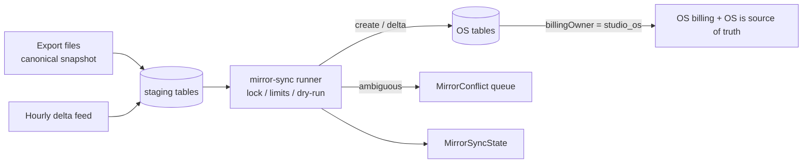

# Mirror mode: migrating off a legacy booking and billing vendor

This is the pattern used to move a live studio off a hosted booking, membership and billing product (called **LegacyBookingVendor** here) without a big-bang cutover. It contains no data and no row counts. The runnable skeleton is in `scripts/mirror-sync.skeleton.ts` and the decision record is ADR 0004.

## Phases

1. **Shadow.** Import everything and bill nothing. Every customer starts as `billingOwner=legacy_vendor`. Staff use the OS for CRM and booking views while the vendor still charges cards.
2. **Parallel run.**
   - The mirror runs hourly for deltas and daily for a full pass.
   - Conflicts go to a staff queue.
   - Sync state shows freshness and errors for each data type.
3. **Per-customer cutover.**
   - Card vault tokens are transferred.
   - The customer's renewal is cancelled in the vendor and their `billingOwner` is flipped to `studio_os`.
   - From then on the mirror skips that customer and the OS billing job picks them up.

   Family or shared plans flip as a group.
4. **Retire.**
   - Turn off the mirror jobs.
   - Keep the `legacy*Id` columns for audit and refund lookups.
   - Archive the staging tables.

## Runner rules

| Rule | Why |
|---|---|
| One-way (legacy to OS) only | The vendor stays the system of record until cutover. Never write back. |
| Stage first, then upsert | Importers can be re-run, and the runner can be diffed against staging. |
| Session advisory lock | Hourly and daily runs must never overlap. |
| Change limit per entity (abort the run) | A truncated or garbled export must not rewrite thousands of rows. Use `--force` only for the first bootstrap. |
| `--dry-run` logs every intended write | Every mapping change is reviewed against production data first. |
| No-op detection | Unchanged rows are skipped, which keeps `updatedAt` meaningful and audit noise low. |
| `billingOwner=studio_os` rows are untouchable | This makes cutover a one-way door for each customer. |
| Conflicts keyed by `(entityType, entityId, field)` | Re-runs update one row per open question instead of piling up duplicates. |
| Placeholder phones are imported with a flag, never stored | The vendor used repeated-digit placeholders. Storing them would collide on a unique column and could text a stranger. |
| Matching order: legacy id, then email | The two feeds expose different ids. Email bridges them. |

## Lessons

- **Plan-name mapping is the long tail.** Unknown plan names go to the conflict queue with snapshots from both systems. Guessing is never acceptable.
- **Billing must come from exactly one system for each customer.** Billing selects customers by `billingOwner`, not by "has a card".
- **Imported charges are not gateway-refundable.** The vendor never exposed gateway transaction ids, and the refund path rejects such charges with a clear message.
- **Retire the mirror explicitly.** A scraper-based delta feed breaks when the vendor's UI changes. Disable its cron and record the reason, rather than letting it fail quietly.
